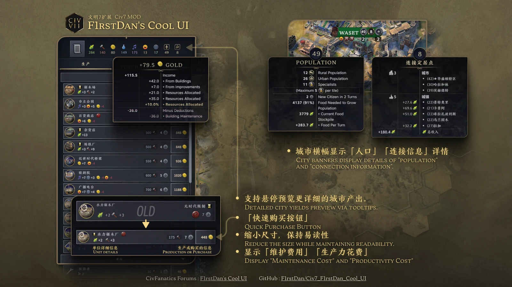

# F1rstDan's Cool UI | Civ7 MOD

  
  
  
  

  

  快速购买按钮　·　更详细的城市信息　·　更紧凑更美观 
  <em>Quick-buy buttons · richer city information · a tighter, cleaner layout</em>

## 功能 | Features

- **一键快捷购买** — 在生产条目末尾直接购买单位或建筑；悬停按钮可查看折扣信息。
- **城市产出详情** — 悬停城市产量栏，查看收入来源、维护支出、资源分配等明细。
- **城市横幅增强** — 直接看到人口和连通状态；悬停查看人口构成、食物增长、连接定居点与总收入。
- **紧凑生产列表** — 缩短条目高度，同时显示所需生产力与维护费用；可在设置中关闭。

*Quick-buy controls, detailed yield tooltips, richer city banners, and compact production rows.*

## 兼容性 | Compatibility

**纯 UI，可随时开关。** 模组不涉及游戏数值，可以随时开启或关闭，包括已经进行中的存档。

**为共存而设计。** 通过非侵入式装饰器扩展现有界面，不替换官方核心 UI 文件。若另一个模组也调整生产列表布局，可在设置中关闭「紧凑生产列表」。

*It is a UI-only mod and does not change gameplay values, so you can enable or disable it at any time, including in an existing save. It extends the existing interface with non-intrusive decorators rather than replacing core UI files. If another mod changes the production-list layout, turn off Compact Production List in settings.*

## 安装 | Install

### Steam Workshop（推荐）

在 [Steam 创意工坊](https://steamcommunity.com/sharedfiles/filedetails/?id=3510572267) 订阅，启动游戏即可使用。

或通过 CivMods 安装：[一键安装](https://civmods.com/install?modCfId=31961)

### 手动安装 | Manual

1. 从 [GitHub Releases](https://github.com/F1rstDan/Civ7_F1rstDan_Cool_UI/releases/latest) 或 [CivFanatics](https://forums.civfanatics.com/resources/f1rstdans-cool-ui.31961/) 下载最新版。
2. 解压到对应的 Mods 目录，并确认 `f1rstdan-cool-ui.modinfo` 位于模组文件夹根部。

   - Windows：`%localappdata%\Firaxis Games\Sid Meier's Civilization VII\Mods`
   - macOS：`~/Library/Application Support/Civilization VII/Mods`
   - Steam Deck / Linux：`~/My Games/Sid Meier's Civilization VII/Mods/`

## 版本 | Version

版本、官方游戏兼容性与具体改动请查看 [Changelog.md](Changelog.md)。

*For the current version, game compatibility, and full change history, see [Changelog.md](Changelog.md).*

## 支持 | Support

如果这个模组让你的城市管理更顺手，欢迎通过下方任意方式赞赏，或直接访问 [Ko-fi](https://ko-fi.com/f1rstdan)。

*If it saves you time, scan any code below or support directly on [Ko-fi](https://ko-fi.com/f1rstdan).*

  

